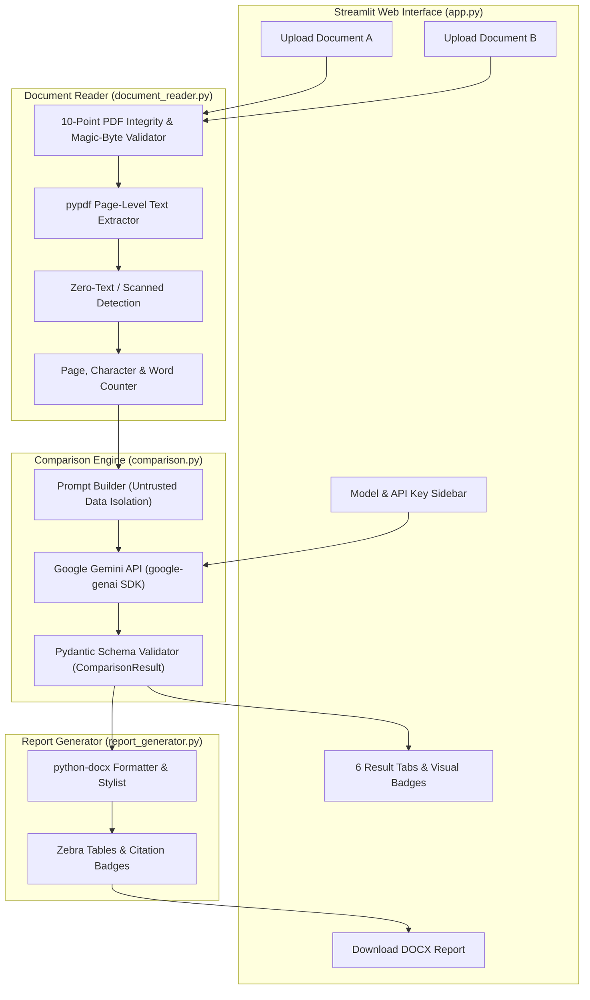

# AI Document Comparison Assistant

**Enterprise-Grade Comparative Intelligence & Audit Tool for Text-Based PDF Documents**

*Developed for the Xpert Champs AI Engineering Internship Submission*

---

## 1. Project Overview

The **AI Document Comparison Assistant** is a production-ready, full-stack Generative AI web application built with Python and Streamlit. It enables users to upload two versions of text-based PDF documents (such as corporate policies, university syllabi, vendor agreements, project specifications, or product documentation), inspect extracted textual contents, generate isolated summaries, detect meaningful similarities and differences, compare concrete factual attributes (dates, stipends, eligibility criteria, and obligations), and export a branded Microsoft Word (`.docx`) executive comparison report.

Unlike naive LLM wrappers that merely pass unconstrained prompts to a conversational bot, this system implements an end-to-end engineered architecture:

- **Strict Document Extraction & Integrity Boundaries:** Powered by `pypdf`, tracking page-by-page text, character metrics, and page citations.
- **Untrusted Content Isolation:** Treats document text as passive data to defend against prompt injection.
- **Evidence-Grounded AI Engine:** Uses Google's official `google-genai` SDK with strict JSON schema enforcement via Pydantic to eliminate hallucinated differences.
- **Executive Streamlit UI/UX:** Features responsive dual-card uploaders, text inspection drawers, 6 categorized analysis tabs, difference filtering badges, and one-click sample document loading.
- **Publication-Quality Report Generation:** Produces clean `.docx` reports with customized color palettes, metadata headers, comparison tables, and compliance disclaimers.

> **Informational Scope Disclaimer:** This application is designed solely as an informational document-analysis assistant. It does not provide legal advice and does not determine legal validity, regulatory compliance, or contractual enforceability.

---

## 2. Key Features

- **Dual PDF Upload & Inspection:** Separate drop zones for Document A (Baseline) and Document B (Comparison) displaying filename, page count, word count, character count, and an expandable text preview.
- **Ten-Point Validation Engine:** Rejects empty files (0 bytes), invalid non-PDF formats, missing headers (`%PDF-`), corrupted streams, password-encrypted files, and oversized documents.
- **Scanned Document Detection:** Flags scanned/image-only PDFs lacking digital text layers, clearly explaining that OCR is unsupported rather than fabricating an analysis.
- **Evidence Citations:** Quotes direct verbatim excerpts and links specific page numbers (`p. 1`, `pp. 1, 2`) to every similarity, difference, and key detail.
- **Categorized Change Taxonomy:** Classifies differences into `[ADDED]`, `[REMOVED]`, `[MODIFIED]`, `[CONTRADICTION]`, and `[WORDING_ONLY]` with interactive filtering.
- **Side-by-Side Key Details Matrix:** Compares quantitative parameters (dates, deadlines, allowances, fees, eligibility rules) side-by-side with explicit `Not found in the provided text` markers.
- **Downloadable DOCX Report:** Generates an executive Word document with zebra-striped tables, branded palettes, and audit notices.
- **Fast Demo Mode:** Includes a bundled "Load Sample Documents" button that instantly loads realistic synthetic corporate policies (`policy_v1.pdf` and `policy_v2.pdf`).

---

## 3. System Architecture



---

## 4. Repository Structure

```text
ai-document-comparison-assistant/
├── app.py                     # Streamlit web application & UI presentation logic
├── document_reader.py         # PDF validation, text extraction & page citation tracking
├── comparison.py              # Gemini AI comparison engine & prompt engineering
├── report_generator.py        # Executive Microsoft Word (.docx) report generator
├── schemas.py                 # Pydantic data models for structured contract validation
├── config.py                  # Environment configurations, models, and guardrail limits
├── requirements.txt           # Project dependencies
├── .env.example               # Template for environment configuration
├── .gitignore                 # Excludes secrets, virtual environments, and caches
├── README.md                  # Comprehensive documentation & internship defense guide
├── run_windows.bat            # Automated one-click launcher for Windows 11
├── sample_documents/          # Bundled demonstration PDFs
│   ├── policy_v1.pdf          # Baseline Remote Work Policy (2024 - v1.2)
│   ├── policy_v2.pdf          # Revised Remote Work Policy (2025 - v2.0)
│   └── generate_samples.py    # Generator script for sample documents
└── tests/                     # Automated unit and integration test suite
    ├── test_document_reader.py # 12 automated tests for PDF extraction & edge cases
    ├── test_comparison.py     # 9 automated tests for prompt, schema & error handling
    └── test_report_generator.py # 4 automated tests for DOCX structure & empty sections
```

---

## 5. Technology Stack & Justification

| Technology | Version / Component | Role & Technical Justification |
| :--- | :--- | :--- |
| **Python** | 3.10+ (tested on 3.14) | Core programming language offering rich typing, dataclass, and AI ecosystem support. |
| **Streamlit** | 1.35.0+ | Modern reactive web framework delivering instant user interactions without heavy frontend overhead. |
| **Google GenAI** | `google-genai>=2.0.0` | Google's current, official SDK for Gemini 2.5 Flash / 1.5 Flash with native structured output. |
| **pypdf** | 4.0.0+ | Pure-Python PDF parser providing fast, dependency-free text extraction and page trees. |
| **python-docx** | 1.1.0+ | Generates enterprise Microsoft Word documents with full control over XML cell shading and margins. |
| **Pydantic** | 2.0.0+ | Strict runtime data validation guaranteeing the LLM response adheres to the JSON contract. |
| **pytest** | 8.0.0+ | Industry-standard test framework for fast, deterministic unit test verification. |

---

## 6. Windows 11 Installation & Setup

### Option A: One-Click Automated Launcher (Recommended)

Double-click `run_windows.bat` in the project root folder. The script will automatically:
1. Verify that Python is installed and accessible.
2. Create an isolated virtual environment (`venv`) if one does not exist.
3. Activate the virtual environment.
4. Install or upgrade dependencies from `requirements.txt`.
5. Create a default `.env` from `.env.example` if missing.
6. Launch the Streamlit web application in your browser.

### Option B: Manual Command-Line Setup

1. **Open PowerShell or Command Prompt** in the project directory:
   ```powershell
   cd e:\xperts_internship\AI_Document_Comparison_Assistant
   ```

2. **Create and activate a virtual environment:**
   ```powershell
   python -m venv venv
   .\venv\Scripts\activate
   ```

3. **Install dependencies:**
   ```powershell
   pip install --upgrade pip
   pip install -r requirements.txt
   ```

4. **Configure your environment file:**
   ```powershell
   copy .env.example .env
   ```
   Open `.env` in any text editor and supply your Gemini API key:
   ```env
   GEMINI_API_KEY=AIzaSyYourActualKeyHere
   GEMINI_MODEL=gemini-2.5-flash
   ```

5. **Start the Streamlit application:**
   ```powershell
   python -m streamlit run app.py
   ```
   Open [http://localhost:8501](http://localhost:8501) in your browser.

---

## 7. Gemini API Key Configuration & Security

1. Visit [Google AI Studio](https://aistudio.google.com/) and generate a free Gemini API key.
2. You can provide the API key in two secure ways:
   - **Environment Variable (Recommended):** Set `GEMINI_API_KEY` inside `.env`. The file is ignored by `.gitignore` and will never be committed to source control.
   - **Application Sidebar:** Input the key directly into the password-masked field in the Streamlit sidebar during your active session.
3. **Security Assurance:**
   - Keys are kept strictly on the local machine and sent only via HTTPS to Google's API endpoint.
   - API keys are never rendered in logs, UI screens, tracebacks, or exported DOCX reports.

---

## 8. Sample Documents Walkthrough

The project includes two realistic, synthetic corporate policy documents in `sample_documents/`:
- `policy_v1.pdf`: **TechCorp Remote Work and Equipment Policy (2024 - v1.2)**
- `policy_v2.pdf`: **TechCorp Remote Work and Equipment Policy (2025 - v2.0)**

### Documented Ground-Truth Differences:

| Policy Aspect | Document A (2024 - v1.2) | Document B (2025 - v2.0) | Change Classification |
| :--- | :--- | :--- | :--- |
| **Eligibility Tenure** | 6 months minimum tenure | 3 months minimum tenure | `[MODIFIED]` |
| **Intern Eligibility** | Strictly ineligible | Eligible for 50% stipend upon manager approval | `[ADDED]` |
| **Core Working Hours** | 10:00 AM – 4:00 PM EST | 10:00 AM – 3:00 PM EST | `[MODIFIED]` |
| **Equipment Stipend** | **$500.00 USD** one-time | **$750.00 USD** one-time | `[MODIFIED]` |
| **Reimbursement Window** | Submit receipts within **30 days** | Submit receipts within **15 days** | `[MODIFIED]` |
| **Cybersecurity (MFA)** | Password update every 90 days | Added mandatory FIDO2 hardware security keys | `[ADDED]` |
| **VPN Requirement** | Mandatory corporate VPN connection | Mandatory corporate VPN connection | `[SAME]` (Similarity) |
| **Policy Review Date** | December 15, 2024 | December 15, 2025 | `[MODIFIED]` |

### How to Test with Sample Documents in 5 Seconds:
1. Launch `python -m streamlit run app.py`.
2. In the left sidebar under **🚀 Fast Demo**, click **📁 Load Sample Documents**.
3. Observe the extracted text previews, page metrics, and character stats.
4. Click **🚀 Compare Documents** to observe full evidence-grounded extraction.

---

## 9. Automated Testing Suite

The project includes 25 comprehensive automated tests running on `pytest`. All tests use mock clients or synthetic in-memory PDFs, ensuring **zero API quota consumption** and **100% offline reliability**.

To run the automated tests:
```powershell
python -m pytest -v
```

### Test Suite Coverage Breakdown (25 Tests):

```text
tests/test_comparison.py
  ✓ test_clean_json_response_with_markdown_blocks
  ✓ test_build_comparison_prompt
  ✓ test_successful_mock_comparison
  ✓ test_missing_api_key_raises_error
  ✓ test_malformed_json_response_handling
  ✓ test_schema_validation_failure
  ✓ test_api_rate_limit_error (429 handling)
  ✓ test_api_permission_denied_error (403 handling)
  ✓ test_combined_length_limit

tests/test_document_reader.py
  ✓ test_valid_pdf_extraction
  ✓ test_sample_documents_extraction
  ✓ test_missing_document
  ✓ test_empty_zero_byte_file
  ✓ test_unsupported_file_extension
  ✓ test_invalid_pdf_bytes (magic header %PDF-)
  ✓ test_corrupted_pdf_stream
  ✓ test_scanned_image_only_pdf (OCR fallback notice)
  ✓ test_file_size_limit_exceeded
  ✓ test_page_limit_exceeded
  ✓ test_character_limit_exceeded
  ✓ test_validate_document_pair

tests/test_report_generator.py
  ✓ test_generate_docx_report_buffer
  ✓ test_docx_content_and_sections
  ✓ test_docx_empty_sections_handling
  ✓ test_docx_save_to_file
```

---

## 10. Requirement Completion Checklist

| Requirement ID | Specification | Status | Implementation Details |
| :--- | :--- | :---: | :--- |
| **FR-01** | Upload two PDF files & display filenames | ✅ Complete | Dual drop zones in `app.py` with filename displays. |
| **FR-02** | Validate files (empty, corrupt, wrong type) | ✅ Complete | 10-point validation checks in `document_reader.py`. |
| **FR-03** | Extract text & maintain page citations | ✅ Complete | `pypdf` extracts page-by-page text with `DocumentPage` models. |
| **FR-04** | Preview extracted content & counts | ✅ Complete | Page count, character count, word count & text preview drawers. |
| **FR-05** | Summarize Document A & Document B separately | ✅ Complete | Independent executive summaries in Result Tabs 1 & 2. |
| **FR-06** | Compare similarities with evidence | ✅ Complete | Common provisions listed with verbatim quotes & page numbers. |
| **FR-07** | Compare differences with taxonomy | ✅ Complete | Added, Removed, Modified, Contradiction, Wording-only badges. |
| **FR-08** | Highlight key details (dates, fees, criteria) | ✅ Complete | Side-by-side interactive dataframe comparing factual metrics. |
| **FR-09** | Display results in 6 labelled tabs | ✅ Complete | Tabs: Summary A, Summary B, Similarities, Differences, Key Details, Conclusion. |
| **FR-10** | Downloadable comparison report | ✅ Complete | Generates and downloads styled Microsoft Word (`.docx`) file. |
| **FR-11** | Robust error handling (APIs, limits, timeouts) | ✅ Complete | Specific handlers for 429 quota, 403 auth, 404 models, and limits. |
| **FR-12** | Reset and compare again | ✅ Complete | Clean reset function clears session state without residual bugs. |

---

## 11. Technical Viva & Defense Guide

*Use these detailed technical explanations during your internship viva presentation:*

### Q1: Why did you use `pypdf` instead of OCR tools like Tesseract?
> **Answer:** "The assignment specification focuses on text-based PDF documents (course syllabi, policy documents, specifications). `pypdf` is a lightweight, pure-Python library that extracts digital text vectors and font streams reliably without native system C-library dependencies. For scanned PDFs (which contain raster images rather than text glyphs), our system detects zero extractable characters and explicitly notifies the user that the document contains only scanned imagery and that OCR is not supported in this version. This prevents the model from hallucinating or pretending to analyze unreadable images."

### Q2: How does the system prevent prompt injection from malicious PDF text?
> **Answer:** "We establish an explicit boundary between instructions and untrusted data in `comparison.py`. Document texts are clearly isolated inside delimiter blocks (`==================== DOCUMENT A ====================`). The system instruction explicitly directs the LLM to treat document text strictly as passive data, forbidding it from executing any embedded commands (such as 'ignore previous instructions')."

### Q3: How do you guarantee the model does not invent differences?
> **Answer:** "We employ three techniques:
> 1. **Prompt Constraint:** The model is forbidden from reporting differences based merely on formatting or equivalent phrasing; rewordings are explicitly marked as `wording_only`.
> 2. **Explicit Absence of Evidence:** When a factual attribute is missing from a document, the model is required to return `'Not found in the provided text'` rather than speculating.
> 3. **Structured Schema Validation:** We use Google GenAI's `response_schema` backed by Pydantic models (`ComparisonResult`). Every output field is strongly typed and validated before reaching the UI or report generator."

### Q4: Why export to `.docx` rather than `.pdf`?
> **Answer:** "`python-docx` allows programmatically styling clean typography, table cell shading, padding, and text runs with zero external binary dependencies. Furthermore, business and administrative users (HR, managers, administrators) often need to annotate, review, or copy comparison notes into internal memos, which makes editable `.docx` files significantly more practical than static PDFs."

---

## 12. Git & GitHub Submission Instructions

To push this repository to GitHub for your internship submission:

```powershell
# 1. Initialize git repository (if not already initialized)
git init

# 2. Verify git status (confirm .env and venv are ignored)
git status

# 3. Add all project files
git add .

# 4. Commit with conventional commit message
git commit -m "feat: complete AI Document Comparison Assistant project for internship submission"

# 5. Set main branch and connect remote repository
git branch -M main
git remote add origin https://github.com/your-username/ai-document-comparison-assistant.git

# 6. Push to GitHub
git push -u origin main
```

---

## 13. Project Metadata

- **Student:** Final-Year B.Tech Information Technology
- **Internship:** Xpert Champs AI Engineering Internship
- **Project Title:** AI Document Comparison Assistant
- **Delivery Date:** Submission-Ready
- **License:** Educational / Internship Project

